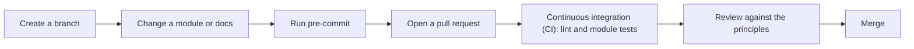

# 🤝 Contributing

This page explains how to change a module, add a new module, and keep the documentation current. The rules come from the repository [constitution](../.specify/memory/constitution.md); where this page and the constitution differ, the constitution wins.

> [!NOTE]
> This page is a point-in-time baseline (November 2026). The constitution and the repository files are authoritative.

## 🔄 Contribution flow



1. Create a branch and make the change.
2. Run `pre-commit run --all-files` until it passes. See [Documentation workflow](#-documentation-workflow).
3. Open a pull request. The description lists the proposed changes (the pull request template starts with **Proposed changes**). Call out breaking changes explicitly: renamed or removed variables or outputs, and defaults that change deployed resources.
4. The `Lint and Test` workflow and the workflow of every changed module must pass. See [Testing and automation](testing-and-automation.md).
5. Reviewers verify the four principles below before approving. `CODEOWNERS` assigns every path to the `PerfectThymeTech/csa-admins` team.

For bugs, feature ideas and documentation problems, use the issue templates in the repository.

## 🧭 The four principles in short

| Principle | What it means for a change |
|-----------|----------------------------|
| **Azure first** | Modules wrap Azure services. Use `azurerm` first, then `azapi`, then the Fabric provider for Fabric items. Use Azure-native capabilities such as Microsoft Entra ID, managed identities, role-based access control (RBAC) and Private Link. |
| **Documentation for all content** | Every module, variable, output and script is documented so a consumer does not need to read the source. |
| **Secure by default** | With only required inputs, a module deploys its most secure configuration. An exception is allowed only when the secure setting blocks critical functionality, and it must be documented. |
| **Terraform plus PowerShell and Azure command-line interface (CLI)** | Terraform declares infrastructure. Last-mile steps that no provider can perform use `pwsh` and the Azure CLI only. |

## 🆕 Add a new module

A pull request that adds a module contains all of the following:

| Deliverable | Location | Notes |
|-------------|----------|-------|
| Module code | `modules/<name>/` | Use only the files that apply, as listed in [Module anatomy](module-anatomy.md). Declare providers in `terraform.tf` (`azurerm` constrained to `~> 5.0`). Do not add `provider` blocks. |
| Documentation | `README_header.md`, `README_footer.md`, generated `README.md` | Follow the [header layout](#-documentation-workflow). Every `variable` and `output` needs a `description`; every script needs a header comment. |
| Tests | `tests/test.tftest.hcl` | Run with `terraform test`. A `tests/setup/` module that needs other modules references them by relative local path, for example `../../../keyvault`. |
| Continuous integration (CI) workflow | `.github/workflows/terraform-<name>.yml` | Copy an existing module workflow, then change the name, both path filters and `config`. It calls `_terraformTestTemplate.yml`. |
| Root list entry | `README.md` | Add the module to the table of its category, with a link to `modules/<name>/`. |
| Catalog entry | [`docs/module-catalog.md`](module-catalog.md) | Add the module to its category and to the relationship diagram if it composes with other modules. |
| Security entry | [`docs/security.md`](security.md) | Describe the secure defaults and any exception, and add the reason and the recommended mitigation of each exception to the [Reasons and mitigations for exceptions](security.md#-reasons-and-mitigations-for-exceptions) table. |
| Scripted steps | [`docs/scripted-steps.md`](scripted-steps.md) | Only when the module uses a `local-exec` step. |

> [!NOTE]
> You do not add a pre-commit hook or an exclusion entry for a new module. One recursive terraform-docs hook covers every folder under `modules/`.

### Rules for exceptions to secure defaults

When a setting cannot be secure because that would block critical functionality of the service:

- keep the exception as narrow as possible;
- add a short inline code comment that explains it;
- document the setting, the reason and the recommended mitigation under **Exceptions and prerequisites** in `README_header.md`.

A variable that relaxes a secure setting defaults to the secure value. Variables and outputs that carry secrets are marked `sensitive = true`.

### Rules for scripted steps

Use a script only when neither `azurerm` nor `azapi` can perform the operation. The step runs through a `local-exec` provisioner with `interpreter = ["pwsh", "-Command"]` and `on_failure = fail`; the script lives in the module `scripts/` folder, is idempotent, uses the ambient Azure identity and takes no credentials as plain-text arguments. The `terraform_data` or `null_resource` that triggers it defines `triggers`. Do not use other scripting languages.

## 📝 Documentation workflow

Each module page is assembled from three parts:

| Part | Edited by | Content |
|------|-----------|---------|
| `README_header.md` | You | Overview, secure defaults, exceptions and prerequisites, usage |
| Generated reference | terraform-docs | Requirements, providers, resources, modules, inputs and outputs |
| `README_footer.md` | You | Optional closing content; empty in all modules today |

The header of every module follows the same layout:

1. Title with a category icon, then the workflow badge and a one-sentence summary.
2. `## 📦 Overview`: what the module deploys.
3. `## 🛡️ Secure defaults`: what is locked down and how.
4. `## ⚠️ Exceptions and prerequisites`: every security exception, and what must exist before use.
5. `## 🚀 Usage`: a minimal example with the required inputs and a `<release-tag>` placeholder.

Never edit the generated `README.md` by hand. Edit `README_header.md`, `README_footer.md`, or the Terraform code (descriptions, types, defaults) and regenerate.

### Add a documentation page

When you add a page under `docs/`, add it with a one-line description to the [documentation index](README.md) and link it from the "Where to go next" section of the [root README](../README.md). Those two files are the only places that list the pages.

### Regenerate the pages

```bash
pip install -r requirements.txt
pre-commit install
pre-commit run --all-files
```

The first run exits with a failure when a hook changed files; run it again and it passes. The same hooks run in CI, so a stale `README.md` fails the `Lint and Test` workflow.

### How generation is configured

| Setting | Location | Effect |
|---------|----------|--------|
| One recursive hook (`terraform-docs-go`) | `.pre-commit-config.yaml` | Regenerates every module page in one pass. No per-module hook. |
| `types: [text]` and `files: ^modules/` | `.pre-commit-config.yaml` | The hook also runs when only `README_header.md` or `README_footer.md` changes. |
| Relative config path `-c .terraform-docs.yml` | `.pre-commit-config.yaml` | Recursive mode applies the shared configuration to each module. |
| `exclude: ^modules/[^/]+/README\.md$` | `.pre-commit-config.yaml` | Keeps the whitespace hooks away from generated pages. |
| `recursive.exclude: [tests]` | `.terraform-docs.yml` | Skips the `tests/setup` modules, which have no header file. |
| `include-main: false` | `.terraform-docs.yml` | Does not generate a page for the `modules/` folder. |
| Providers and Resources sections | `.terraform-docs.yml` | Every module page lists its providers and the resources it creates. |
| Pinned version `v0.24.0` | `.pre-commit-config.yaml` | Output is identical for everyone. A different locally installed terraform-docs can produce a different page, so always generate through pre-commit. |

> [!TIP]
> `pre-commit run --all-files` only checks files that Git tracks. For a new file, run `git add -N <file>` (intent to add) first so the hygiene hooks check it as well.

## ✅ Before you open the pull request

- `pre-commit run --all-files` passes and the regenerated `README.md` files are part of the change.
- Documentation is updated for every changed variable, output, default or behavior.
- No secret, tenant identifier (ID), subscription ID or client ID is added to documentation.
- For a new module: all deliverables in the table above exist.
