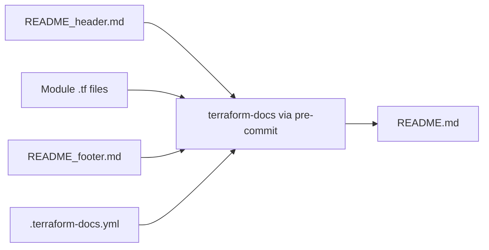

# 🧩 Module anatomy

Every folder under `modules/` follows the same layout. A module only contains the files that apply to it. This page lists the standard files and what they are for.

## 📁 Files and folders

| File or folder | Purpose |
|----------------|---------|
| `terraform.tf` | Declares the required Terraform version and the required providers. Modules do not contain `provider` blocks. |
| `variables.tf` | Input variables, each with a description, a type and, where it helps, a validation. |
| `main.tf` | The primary resources of the module. |
| `outputs.tf` | Output values. Secrets such as keys and connection strings are marked sensitive. |
| `data.tf` | Data sources, for example the current client configuration and the available diagnostic categories. |
| `connectivity.tf` | Private endpoints, optional private Domain Name System (DNS) zone groups and the wait (`connectivity_delay_in_seconds`) after the private endpoint. |
| `diagnostics.tf` | Diagnostic settings that are created for each entry of `diagnostics_configurations`. |
| `roleassignments.tf` | Role assignments the module needs, for example for the identity that runs Terraform or for customer-managed keys. |
| `locals.tf` and other `*.tf` files | Module-specific logic or resource groups, for example `sharedprivatelink.tf` in `aisearch` or `managedprivateendpoint.tf` in `datafactory`. |
| `scripts/` | PowerShell scripts that provisioners call for steps Terraform providers cannot express. |
| `tests/` | Terraform test files (`test.tftest.hcl`; `appserviceplan` uses `test001.tftest.hcl` and `test002.tftest.hcl`) and, in some modules, a `tests/setup/` module that creates test prerequisites. |
| `README_header.md` | Hand-written overview: what the module deploys, secure defaults, exceptions and prerequisites, and a usage example. |
| `README_footer.md` | Hand-written content shown at the end of the page. It is empty in all modules today. |
| `README.md` | The module page, assembled by terraform-docs. Never edit it by hand. |

## 📚 How a module page is assembled

The generated part contains the requirements, providers, resources, modules, inputs and outputs. It is rebuilt by the pre-commit hook whenever a file under `modules/` changes; see [Contributing](contributing.md) for the workflow.

## 🧪 Tests and automation

Each module has a workflow in `.github/workflows/` that runs the module's Terraform tests when files of that module change. Details are on the [Testing and automation](testing-and-automation.md) page.
