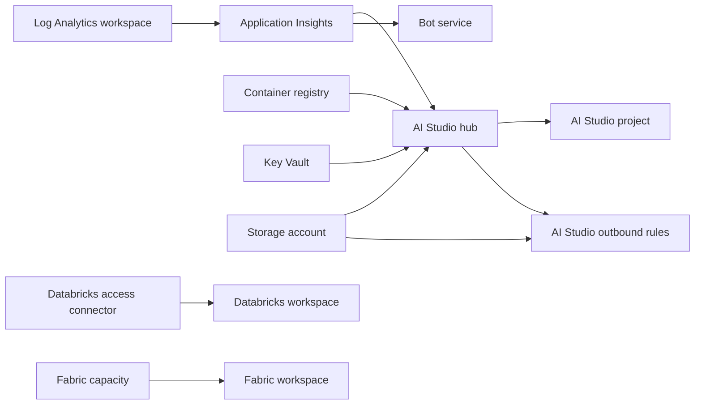

# 🧭 Module catalog

All modules in this repository, grouped by what they are used for. Each entry links to the module page. Every module appears exactly once.

> [!NOTE]
> This page is a point-in-time baseline (November 2026). The module code and each module page are authoritative.

## 🔗 How modules combine

Some modules take the resource identifier (ID) of another module's output. These relationships are required inputs in the module code.

- `aistudiohub` requires the IDs of an Application Insights component, a container registry, a Key Vault and a storage account.
- `aistudioproject` and `aistudiooutboundrules` require the ID of an existing AI Hub; `aistudiooutboundrules` also requires the hub's storage account ID.
- `applicationinsights` requires a Log Analytics workspace ID, and `botservice` requires an Application Insights ID.
- `databricksworkspace` requires the ID of a Databricks access connector.
- `fabricworkspace` looks up an existing Fabric capacity by name.
- Many modules accept `diagnostics_configurations`, where you can pass a Log Analytics workspace ID. See [Common patterns](common-patterns.md).

## 🤖 AI and Cognitive Services

| Module | Service | Purpose |
|--------|---------|---------|
| [aifoundrybasic](../modules/aifoundrybasic/) | Azure AI Foundry (AI Services) | Private-only AI Foundry account with optional projects, model deployments and customer-managed key |
| [aisearch](../modules/aisearch/) | Azure AI Search | Private-only search service with optional shared private links that a script can approve |
| [aiservice](../modules/aiservice/) | Azure AI Services (Cognitive Services) | Private-only account of a chosen kind with optional model deployments |
| [aistudiohub](../modules/aistudiohub/) | Azure AI Hub | Network-isolated hub workspace with a private endpoint and optional connections |
| [aistudiooutboundrules](../modules/aistudiooutboundrules/) | Azure AI Hub managed network | Applies all user-defined outbound rules of a hub in one batch |
| [aistudioproject](../modules/aistudioproject/) | Azure AI Project | Project attached to an existing hub, with optional connections |
| [botservice](../modules/botservice/) | Azure Bot Service | Bot with local authentication disabled and private endpoints for Bot and Token |

## 📊 Data and Analytics

| Module | Service | Purpose |
|--------|---------|---------|
| [cosmosdb](../modules/cosmosdb/) | Azure Cosmos DB | Account with public access disabled and private endpoints |
| [datafactory](../modules/datafactory/) | Azure Data Factory | Managed virtual network factory with a private endpoint and optional content deployment steps |
| [databricksaccessconnector](../modules/databricksaccessconnector/) | Azure Databricks | Access connector with a system-assigned managed identity |
| [databricksworkspace](../modules/databricksworkspace/) | Azure Databricks | Premium workspace injected into a virtual network, without public access |
| [fabriccapacity](../modules/fabriccapacity/) | Microsoft Fabric | Capacity with the deploying identity as administrator |
| [fabricworkspace](../modules/fabricworkspace/) | Microsoft Fabric | Workspace on an existing capacity with optional Git, network policy and private link |
| [mssqlserver](../modules/mssqlserver/) | Azure SQL Database | Logical server for Structured Query Language (SQL) databases with Microsoft Entra ID-only authentication and a private endpoint |
| [postgresqlflexible](../modules/postgresqlflexible/) | Azure Database for PostgreSQL | Flexible server with Entra ID authentication only and a private endpoint |
| [purview](../modules/purview/) | Microsoft Purview | Account with private endpoints for the platform and ingestion storage |
| [storage](../modules/storage/) | Azure Storage | Locked-down account with Entra ID-first access and private endpoints |
| [synapseprivetlinkhub](../modules/synapseprivetlinkhub/) | Azure Synapse Analytics | Private link hub with a private endpoint for the web subresource |

## 🔌 Integration and Messaging

| Module | Service | Purpose |
|--------|---------|---------|
| [communicationservice](../modules/communicationservice/) | Azure Communication Services | Communication Services resource with optional diagnostic settings |
| [eventgridnamespace](../modules/eventgridnamespace/) | Azure Event Grid | Namespace with public access disabled, a private endpoint and optional topics |
| [eventhubnamespace](../modules/eventhubnamespace/) | Azure Event Hubs | Namespace with public access disabled, a private endpoint, event hubs and authorization rules |

## 🔐 Security and Identity

| Module | Service | Purpose |
|--------|---------|---------|
| [keyvault](../modules/keyvault/) | Azure Key Vault | Vault with role-based access control (RBAC) authorization, purge protection and a private endpoint |
| [userassignedidentity](../modules/userassignedidentity/) | Azure managed identities | User-assigned managed identity with optional federated identity credentials |

## 📈 Monitoring and Management

| Module | Service | Purpose |
|--------|---------|---------|
| [applicationinsights](../modules/applicationinsights/) | Azure Monitor | Application Insights component linked to a Log Analytics workspace |
| [loganalytics](../modules/loganalytics/) | Azure Monitor | Log Analytics workspace with optional diagnostic settings |

## 🖥️ Compute and Containers

| Module | Service | Purpose |
|--------|---------|---------|
| [appserviceplan](../modules/appserviceplan/) | Azure App Service | Plan with configurable SKU (pricing tier), operating system and worker count |
| [containerregistry](../modules/containerregistry/) | Azure Container Registry | Premium registry reachable only through a private endpoint |
