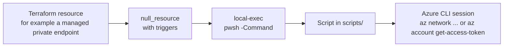

# 🛠️ Scripted steps

Terraform declares all infrastructure in this repository. A few modules also run **last-mile steps**: operations that no Terraform provider can perform today, such as approving a managed private endpoint connection or assigning a Fabric workspace to a domain. This page lists every one of them.

> [!NOTE]
> This is a point-in-time baseline (November 2026). The module code and scripts are authoritative.

## 📏 The rules

Principle IV of the repository [constitution](../.specify/memory/constitution.md) states that last-mile steps:

- are limited to operations that neither `azurerm` nor `azapi` can perform;
- run through a `local-exec` provisioner with `interpreter = ["pwsh", "-Command"]` and `on_failure = fail`, with the script stored in the module `scripts/` folder, and call Azure command-line interface (CLI) commands from PowerShell;
- are idempotent, use the ambient Azure identity of the Terraform run and never take credentials as plain-text arguments;
- are triggered by a `terraform_data` or `null_resource` that defines `triggers`;
- never use other scripting languages.

## ✅ Prerequisites on the machine that runs Terraform

- PowerShell (`pwsh`) and the Azure CLI (`az`) are on the `PATH`.
- You are signed in (`az login`) with an identity that is allowed to perform the operation of the step. The scripts do not accept credentials; they use the Azure CLI session, and the Fabric scripts request a token for `https://api.fabric.microsoft.com/` from it.
- The continuous integration (CI) workflows of `aisearch`, `datafactory` and `fabricworkspace` set `run_azure_login: true` for this reason; see [Testing and automation](testing-and-automation.md).

## 📋 All steps

There are 11 `local-exec` provisioner blocks in 8 `.tf` files across four modules. Files are relative to the module folder.

| # | Module | Step | File | Runs when | Script or command | Interpreter |
|---|--------|------|------|-----------|-------------------|-------------|
| 1 | `aisearch` | Approve a shared private link | `sharedprivatelink.tf` | For each shared private link with `approve = true` (default `false`), on create | `Approve-ManagedPrivateEndpoint.ps1` | `pwsh` |
| 2 | `aistudiooutboundrules` | Approve the private endpoints of outbound rules | `main.tf` | For each private endpoint rule when `ai_studio_hub_approve_private_endpoints` is `true` | `Approve-ManagedPrivateEndpoint.ps1` | `pwsh` |
| 3 | `datafactory` | Start a trigger | `content.tf` | For each name in `data_factory_triggers_start`, only when published content is set | `az datafactory trigger start` | Default shell |
| 4 | `datafactory` | Run a pipeline | `content.tf` | For each name in `data_factory_pipelines_run`, only when published content is set | `az datafactory pipeline create-run` | Default shell |
| 5 | `datafactory` | Approve a managed private endpoint | `managedprivateendpoint.tf` | For every entry of `data_factory_managed_private_endpoints`, on create; there is no opt-out | `Approve-ManagedPrivateEndpoint.ps1` | `pwsh` |
| 6 | `fabricworkspace` | Enable OneLake diagnostics | `diagnostics.tf` | When `workspace_onelake_diagnostics.enabled` is `true`, on create | `Set-WorkspaceOneLakeDiagnostics.ps1` | `pwsh` |
| 7 | `fabricworkspace` | Assign the workspace to a domain | `domain.tf` | When `workspace_domain_id` is set, on create | `Set-WorkspaceDomain.ps1` | `pwsh` |
| 8 | `fabricworkspace` | Remove the workspace from the domain | `domain.tf` | On destroy of the same resource | `Set-WorkspaceDomain.ps1 -Unassign $true` | `pwsh` |
| 9 | `fabricworkspace` | Approve a managed private endpoint | `managedprivateendpoint.tf` | For each endpoint with `approve = true` (no default), on create | `Approve-ManagedPrivateEndpoint.ps1` | `pwsh` |
| 10 | `fabricworkspace` | Apply a tag | `tags.tf` | For each identifier (ID) in `workspace_tag_ids`, on create | `Set-WorkspaceTags.ps1` | `pwsh` |
| 11 | `fabricworkspace` | Remove a tag | `tags.tf` | On destroy of the same resource | `Set-WorkspaceTags.ps1 -Unassign $true` | `pwsh` |

Rows 3 and 4 are inline commands; all other rows call a script in the module's `scripts/` folder (`working_dir` is `${path.module}/scripts/`).

## 📜 Scripts

| Script | Modules | Purpose | Parameters | Permissions the signed-in identity needs |
|--------|---------|---------|------------|------------------------------------------|
| `Approve-ManagedPrivateEndpoint.ps1` | `aisearch` | Finds the private endpoint connection on the target resource whose description equals the request message, waits for it to appear and approves it unless it is already approved | `ResourceId`, `WorkspaceName`, `ManagedPrivateEndpointName`, `RequestMessage` | List, show and approve private endpoint connections on the target resource |
| `Approve-ManagedPrivateEndpoint.ps1` | `aistudiooutboundrules` | Finds the connection by the endpoint name, fails when its status is `Failed`, and approves it unless it is already approved | `ResourceId`, `ManagedPrivateEndpointName`, optional `CheckIntervalInSeconds` and `Retries` (default 10 each) | List and approve private endpoint connections on the target resource |
| `Approve-ManagedPrivateEndpoint.ps1` | `datafactory`, `fabricworkspace` (identical copies) | Finds the connection whose private endpoint ID contains `<WorkspaceName>.<ManagedPrivateEndpointName>`, waits for it to appear and approves it unless it is already approved | `ResourceId`, `WorkspaceName`, `ManagedPrivateEndpointName` | List and approve private endpoint connections on the target resource |
| `Set-WorkspaceDomain.ps1` | `fabricworkspace` | Calls the Fabric Representational State Transfer (REST) application programming interface (API) `assignToDomain` or, with `-Unassign $true`, `unassignFromDomain` | `WorkspaceId`, `DomainId`, optional `Unassign` | Permission to assign workspaces to the domain in Fabric |
| `Set-WorkspaceTags.ps1` | `fabricworkspace` | Calls the Fabric REST API `applyTags` or, with `-Unassign $true`, `unapplyTags` | `WorkspaceId`, `TagIds`, optional `Unassign` | Permission to apply tags to the workspace in Fabric |
| `Set-WorkspaceOneLakeDiagnostics.ps1` | `fabricworkspace` | Calls the Fabric REST API `onelake/settings/modifyDiagnostics` to enable diagnostics with a lakehouse as the destination | `WorkspaceId`, `OneLakeDiagnosticsWorkspaceId`, `OneLakeDiagnosticsLakehouseId` | Permission to change OneLake diagnostics settings of the workspace in Fabric |

The approval scripts use `az network private-endpoint-connection list`, `show` and `approve`. The Fabric scripts use `az account get-access-token` and `Invoke-RestMethod`. All scripts stop on errors (`$ErrorActionPreference = "Stop"`).

> [!NOTE]
> Fabric supports service principal authentication for only some of its API operations. The `fabricworkspace` page repeats this note. If a step fails when you run as a service principal, check whether the Fabric operation supports it.

## ⚠️ Deviations from Principle IV and gaps

These are reported as found; the documentation baseline does not change code.

| Where | Observation |
|-------|-------------|
| `datafactory/content.tf` (rows 3 and 4) | The steps call `az` directly in the default shell of the machine (`/bin/sh -c` on Linux and macOS, `cmd /C` on Windows) instead of `pwsh`. They set no `on_failure`, define no `triggers`, and are not stored in `scripts/`. |
| `aistudiooutboundrules/main.tf` (row 2) | The provisioner sets no explicit `on_failure` or `when`. Terraform's defaults (`fail` and `create`) match the required behavior, but the constitution asks for an explicit `on_failure = fail`. |
| All seven scripts | None has a header comment that states purpose, parameters and required permissions (comment-based help), which Principle II requires. This page documents them instead. |
| `Approve-ManagedPrivateEndpoint.ps1` in `aisearch`, `datafactory` and `fabricworkspace` | The parameters `CheckIntervalInSeconds` and `CheckFrequency` are accepted but not passed on to the retry function, so the function defaults apply. |
| `aisearch`, `datafactory`, `fabricworkspace` | `null_resource` comes from the `null` provider, which these modules do not declare in `terraform.tf`. Terraform resolves it implicitly to `hashicorp/null`. `aistudiooutboundrules` declares it. |
| `aistudiooutboundrules/main.tf` | Two `depends_on` entries reference `azapi_update_resource.ai_studio_hub_outbound_rules`, which is not declared in the module (the resource is declared as `azapi_resource_action`). |
