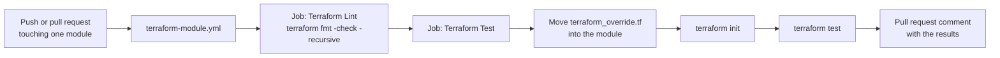

# 🧪 Testing and automation

Every module is tested by its own GitHub Actions workflow. This page describes the workflows, the provider override file and how to run equivalent checks on your machine.

> [!NOTE]
> This page is a point-in-time baseline (November 2026). The files in `.github/workflows/` and `code/utilities/terraform_override.tf` are authoritative.

## ⚙️ Workflows

| Workflow | File | Runs when | What it does |
|----------|------|-----------|--------------|
| Module tests | `.github/workflows/terraform-<module>.yml` (one per module, 27 in total) | Push or pull request to `main` that changes `modules/<module>/**` or the workflow file | Calls the reusable template for that module |
| Reusable template | `.github/workflows/_terraformTestTemplate.yml` | Called by each module workflow | Format check, then `terraform test` |
| Lint and Test | `.github/workflows/lint.yml` | Push or pull request to `main` | Installs `requirements.txt` and runs `pre-commit run --all-files` |
| Release new major version | `.github/workflows/newMajorVersion.yml` | A release is published, or manually with a tag name | Moves the major version tag to the released tag |

Dependabot (`.github/dependabot.yml`) opens weekly updates for GitHub Actions and for the Terraform provider versions in `code/utilities`.

### Module workflow

A module workflow only sets inputs for the template: the environment (`dev`), the module folder in `config`, the Terraform version, the Node.js version, the tenant and subscription of the test environment, and the `CLIENT_ID` secret. The values for the test environment live in the workflow files and are intentionally not repeated here.

All 27 module workflows run the same Terraform version and the same Node.js version. Three of them (`aisearch`, `datafactory` and `fabricworkspace`) also set `run_azure_login: true`, because those modules call the Azure command-line interface (CLI) from scripts. `fabricworkspace` runs on `ubuntu-latest`; the template default is the `self-hosted` runner label.

### Template jobs

| Job | Steps |
|-----|-------|
| `lint` | Set up Terraform, check out the repository, run `terraform fmt -check -recursive` in `modules/<config>`, and comment the result on pull requests. |
| `test` (needs `lint`) | Set up Node.js and Terraform, check out the repository, optionally sign in with `azure/login`, move the override file into the module, run `terraform init` and `terraform test`, and comment the result on pull requests. Runs of the same module and environment are serialized through a concurrency group. |

### Authentication

Continuous integration (CI) authenticates to Azure with OpenID Connect (OIDC); no stored credentials are used. The test job sets `ARM_USE_OIDC` and `FABRIC_USE_OIDC` and passes the client identifier (ID) from the `CLIENT_ID` secret. The workflow has `id-token: write` permission to request the token. GitHub Actions in the workflows are pinned to a full commit hash (SHA).

## 🧩 Provider override file

Modules do not contain `provider` blocks. For tests, the template moves `code/utilities/terraform_override.tf` into the module folder before `terraform init`. Terraform treats files named `*_override.tf` as overrides, so the file adds:

- pinned versions of the `azurerm`, `azapi` and `time` providers;
- provider configuration for `azurerm` and `azapi` (public cloud, no automatic resource provider registration, Microsoft Entra ID authentication for storage, and test-friendly purge and delete behavior for resources such as Key Vault and cognitive accounts).

Updating the provider versions in this file updates the version that all module tests use. Dependabot monitors the file.

## 🧪 Module tests

Each module has its tests in `tests/`:

| Item | Description |
|------|-------------|
| `test.tftest.hcl` | The Terraform test file with `run` blocks and assertions. `appserviceplan` uses `test001.tftest.hcl` and `test002.tftest.hcl` instead. |
| `tests/setup/` | An optional helper module that creates prerequisites, for example `aistudiohub` needs Application Insights, a container registry, a Key Vault and a storage account. |

Test setups reference the other modules of this repository by relative local path (for example `../../../keyvault`), never by a remote `?ref=main` source. This way a test always runs the code of the same pull request.

> [!NOTE]
> The tests use `command = apply`: they create real Azure resources and Terraform destroys them at the end of the test run. The inputs in the test files point to a resource group, subnet and private Domain Name System (DNS) zones of the maintainers' test environment.

## 💻 Run checks locally

| Check | Command | Needs Azure |
|-------|---------|-------------|
| Format | `terraform fmt -check -recursive` in a module folder | No |
| Documentation and file hygiene | `pre-commit run --all-files` in the repository root | No |
| Initialize and validate a module | `terraform init -backend=false` and `terraform validate` in a module folder | No (downloads providers) |
| Module tests | `terraform test` in a module folder | Yes |

To reproduce what CI does for `terraform test`:

1. Sign in with `az login` (or set the `ARM_*` environment variables for your identity).
2. Copy `code/utilities/terraform_override.tf` into the module folder. Do not commit the copy.
3. Replace the resource IDs and names in the test file with resources of your own test environment.
4. Run `terraform init` and `terraform test`.

> [!WARNING]
> Remove the copied override file after the run. Modules must not contain `provider` blocks or the override file in the repository.
